# Remote Access With Cloudflare Tunnel

Keystone's HTTP transport is designed to stay local. It binds to `127.0.0.1`
by default, and Cloudflare Tunnel is the intended way to expose it without
opening an inbound port on your machine. Cloudflare Access authenticates callers
at the edge, then Keystone verifies the forwarded Access JWT again before
routing the request to a stone.

```mermaid
flowchart LR
  client[claude.ai or Claude Desktop]
  cf["Cloudflare Edge\n(Access JWT issued)"]
  tunnel["cloudflared service\n(local Windows service)"]
  keystone["keystone HTTP\n127.0.0.1:8787"]
  middleware["CloudflareAccessMiddleware\n(verifies JWT offline)"]
  dispatch["Host-header dispatch\nstone.your-domain.com -> stone"]

  client -->|"HTTPS to stone.your-domain.com/mcp"| cf
  cf -->|"adds Cf-Access-Jwt-Assertion"| tunnel
  tunnel -->|"plain HTTP, loopback only"| keystone
  keystone --> middleware --> dispatch
```



## Prerequisites

- A domain added to your Cloudflare account.
- Cloudflare Zero Trust enabled for the account.
- A stone installed under `stones_pkg/<stone_name>/` and bootstrapped with
  `uv run python scripts/bootstrap_stones.py`.
- Keystone configured to run the HTTP transport on the default loopback address:
  `KEYSTONE_HTTP_HOST=127.0.0.1` and `KEYSTONE_HTTP_PORT=8787`.

## 1. Create The Tunnel

In the Cloudflare dashboard, go to Zero Trust > Networks > Tunnels and create a
tunnel. Choose the `cloudflared` connector and copy the Windows install token.

Install `cloudflared` as an administrator from this repository:

```powershell
.\scripts\install_cloudflared.ps1 -Token "<cloudflare-tunnel-token>"
```

The script downloads `cloudflared.exe` if needed, removes any existing
`cloudflared` service, installs the service with the provided token, and starts
it.

Verify the service is running:

```powershell
Get-Service cloudflared
```

## 2. Add Public Hostnames

In Zero Trust > Networks > Tunnels > your tunnel > Public hostnames, add one
hostname for each stone you want to expose:

```text
<stone>.<your-domain> -> http://localhost:8787
```

For example, a stone named `my_stone` could be exposed as:

```text
my_stone.example.com -> http://localhost:8787
```

Keystone chooses the stone from the leading subdomain in the `Host` header. If a
stone declares `http_subdomain_aliases` in its `config.json`, those aliases can
be used as shorter public hostnames while the canonical stone name remains
unchanged.

If you prefer a file-based `cloudflared` configuration instead of Cloudflare's
dashboard-managed public hostnames, start from
`scripts/cloudflared.config.example.yml`.

## 3. Protect Each Hostname With Access

For each exposed stone, create a Cloudflare Access application:

- Type: Self-hosted.
- Application domain: `<stone>.<your-domain>`.
- Identity provider: One-time PIN, Google, GitHub, or whatever your account uses.
- Policy: include only the users or groups allowed to call this stone.

After creating the Access application, copy its Application Audience (AUD) tag.
Keystone uses that value to verify the `Cf-Access-Jwt-Assertion` header that
Cloudflare forwards to the origin.

## 4. Configure Keystone

Copy `.env.example` to `.env`, then set:

```dotenv
KEYSTONE_BASE_DOMAIN=example.com
CF_ACCESS_TEAM=<your-team-slug>
CF_ACCESS_AUD_MY_STONE=<access-application-aud-tag>
```

`CF_ACCESS_TEAM` is the slug before `.cloudflareaccess.com`. For example, if
your Access issuer is `https://acme.cloudflareaccess.com`, set:

```dotenv
CF_ACCESS_TEAM=acme
```

The audience variable name must be:

```text
CF_ACCESS_AUD_<STONE_OR_ALIAS>
```

Use the stone subdomain or alias, uppercased. Keystone lowercases the suffix at
runtime before matching it against the request subdomain, so
`CF_ACCESS_AUD_MY_STONE` protects `my_stone.example.com`.

For local development, leave `CF_ACCESS_TEAM` unset. The Cloudflare Access
middleware becomes a no-op, which lets you test the HTTP transport without a
tunnel or Access token.

## 5. Run Keystone HTTP

Start Keystone with the HTTP transport:

```powershell
uv run keystone --transport http
```

Unlike stdio mode, HTTP mode serves every discovered stone from one process.
Incoming requests are routed by hostname.

## 6. Verify The Setup

Check the local server:

```powershell
curl.exe http://127.0.0.1:8787/healthz
```

Local health checks include the discovered stone names. Public health checks are
intentionally minimal:

```powershell
curl.exe https://<stone>.<your-domain>/healthz
```

Then connect your MCP client to:

```text
https://<stone>.<your-domain>/mcp
```

If Access is enabled and the client is not authenticated, Keystone returns a
`WWW-Authenticate` challenge that points the client at the Cloudflare Access
authorization server.

## Optional: Geo-Block Hardening

After the connector has seen real traffic, you can consider a Cloudflare WAF
rule that blocks non-US requests. Run the manual checklist first:

```powershell
uv run python scripts/verify_anthropic_egress.py
```

Only enable a country block after confirming your successful client traffic
comes from expected US-based egress locations. Watch WAF events afterward for
false positives.
