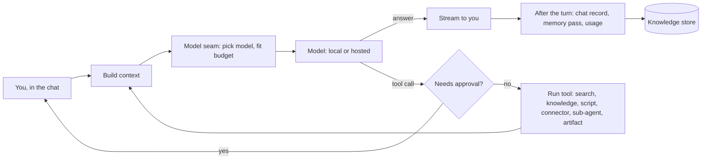

# Brief: Keystone reboot

Type: new
Requester: Jonathan
Owner: Jonathan
Status: clear
Last updated: 2026-11-24

## The ask
"Help me start Keystone from scratch again. I want exactly how Claude.ai does its agents but as my own. It should use local run models and our models from Claude platform and OpenAI and OpenRouter and LiteLLM. We should integrate into Waymarks as well. I want it to look and have features as the chat interface in Claude. All of it. One point we have is memory/context management: where would that live and how Waymarks works."

Later rounds, condensed from his words:
- Borrow as much as needed from New Keystone. Go and React. Build it the way Waymarks was built.
- Never happy with New Keystone's interface: theme, logo, padding, font size and animation were missing. Model everything on Claude (interactions, features, clicks, buttons) and add features beyond it where needed.
- In the UI you see the work being done: multi-agent orchestration, sub-agents, background work. Agents can write scripts.
- The rolling chat did not let him start fresh or come back to something. Wants to attach other chats and hand off into a fresh chat.
- Nothing deferred: one complete end-to-end build.
- Context must always fit the model, and calls should be optimized so context is not sent when not needed. A model router will be its own app; what, if anything, belongs in the harness?
- Everything configurable, defaults chosen for the best experience, full transparency.
- Multi-tenant is required.
- Must work without Waymarks: bring your own wiki or storage, loosely coupled. Not everything belongs in Waymarks; chats are a train of thought (what, why, when we talked about it).

## At a glance

## The problem
Jonathan wants his own Claude.ai-style agent workspace that he controls: any model (local or hosted), visible agent work, and pluggable long-term memory (Waymarks first). New Keystone grew feature by feature, its interface never reached the polish he wants, and its single rolling chat makes it hard to start fresh or return to earlier work.

## Why now
Waymarks is built (phases 0 to 12). Keystone is its first real agent, so Keystone's context design now decides how memory works for everything after it.

## Done looks like
- He uses it daily instead of claude.ai for personal work, from the laptop and the phone.
- Every feature in the inventory below works end to end in one release.
- It looks and behaves like Claude: layout, interactions, motion, type, spacing; with Keystone's own name, mark and themes.
- Any configured model can be picked per chat: local (Ollama / Mac mini Qwen), Anthropic, OpenAI, OpenRouter, LiteLLM.
- While an agent works he can watch its steps, sub-agents and background tasks.
- No call ever exceeds the chosen model's context window, and every turn shows what was sent, its tokens and its cost.
- It works with Waymarks, with the built-in store, or with no knowledge store at all.
- Two tenants (people) on one install cannot see each other's chats, files, memory or keys.

## Feature inventory
Modeled on Claude.ai:
- Chats: sidebar with recents, starred, search; rename, delete; share.
- Messages: streaming, markdown and code with copy, edit and retry with branch navigation, stop, feedback.
- Model picker per chat; extended thinking toggle and visible thinking.
- Projects: instructions, knowledge files, project-scoped chats and memory.
- Memory: profile, preferences, person map; view, correct and forget; incognito chat.
- Styles (response tone/format presets).
- Uploads: files and images; attach other chats (beyond Claude).
- Artifacts: code, HTML, React, SVG, Mermaid, markdown docs; side panel; versions; publish/download.
- Inline visuals: charts and diagrams in the reply.
- Tools: web search and fetch with citations; research mode (long multi-source report).
- Code execution sandbox: agents write and run scripts, create files; saved scripts as reusable tools. (Deferred until the sandbox is researched.)
- Agents: visible tool steps, sub-agents in parallel, background tasks that outlive the tab.
- Connectors (MCP, local and remote) and a tools menu to toggle them.
- Skills.
- Scheduled tasks.
- Browser use; computer use (decision deferred).
- Voice: dictation and voice mode.
- Past-chat search and reference; handoff into a fresh chat (beyond Claude).
- Settings: profile, appearance (light/dark/themes, font), models and keys, connectors, approvals, usage.
Carried from New Keystone (beyond Claude):
- Approval cards for side effects (email, calendar, publish, search).
- Turn inspector and Operations/monitoring pages.
- Local models; routines and morning brief (as scheduled tasks).
- Script workflows: sandboxed job runs that produce artifacts, reusing and renaming New Keystone's Factory job, preview and artifact machinery. Factory itself stays a separate idea. (Deferred with scripts.)

## Out of scope
- Agent-written scripts and script workflows, until sandbox research is done. Deferred by Jonathan on 2026-11-24.
- The intelligent model router itself (separate app). Keystone only provides the seam it plugs into.
- A hosted service for others.

## Constraints
- Go core, React/TypeScript web.
- Runs on his own machines first (Windows workstation; Mac mini serves local models).
- Multi-tenant from the start.
- Waymarks never calls a model and holds no keys. Any model work for memory (extraction, page writing, embeddings) is done by Keystone.
- Everything configurable, defaults chosen for the best experience; every decision the system makes is visible.
- Design preferences: settings in config and flags, not hard-coded; feature flags; functional over class inheritance.
- Build pattern follows Waymarks.
- Deadline: none. Personal project; quality and the loop set the pace.
- Budget: hosted model spend defaults to a $100 monthly cap per tenant, a warning as it nears the cap and a stop at it; the cap is a setting.

## What already exists
- **New Keystone** (C:\Users\Jonathan\Documents\New Keystone, Python): chat with streaming, Qwen 3.8 27B on Mac mini, Claude Haiku option, Tavily search with approvals, context budgets, turn inspector, Operations page, Google sign-in, Gmail send cards, Calendar, routines, morning brief, Factory (Codex worker, previews, publish approvals), voice dictation, text attachments, Waymarks link (search_wiki, read_wiki_page, read_wiki_source, save_to_wiki), draft core constitution, large test suite, Keystone logo and palette studies in docs/design. Source to borrow from.
- **Waymarks** (C:\Users\Jonathan\Documents\Waymarks\waymarks, Go + React/Vite): private wiki kept by agents; sources kept unchanged; pages cite sources; spaces; grants per agent token; sensitive spaces; MCP server; catalog and change log; batches and undo; git markdown mirror; bring-your-own embeddings; agent kit jobs; design system in design/. One owner per instance.
- **Old Keystone** (Go, SQLite + sqlite-vec, stones plugins, dakosar.info): superseded.

## Terms
- **Chat**: one conversation with a clear start. Not a single endless thread.
- **Handoff**: a button that opens a fresh chat carrying a summary of the current one, linked back to it.
- **Context**: everything sent to the model for one turn, rebuilt every turn within a token budget.
- **Chat record**: Keystone's own store of each chat: messages, summary, topics, decisions, when and why. The "train of thought". Never moved into the knowledge store.
- **Knowledge store**: the pluggable long-term memory. Waymarks is the first adapter; a built-in store ships for use without Waymarks. (proposed)
- **Profile**: a few always-loaded facts and preferences about the user.
- **Person map**: a small always-loaded directory of what kinds of things the knowledge store holds, per space, generated from its catalog. Not every page.
- **Recall**: how knowledge reaches a turn: the person map (always), an automatic search on every message (always), and the agent's own lookups.
- **Model seam**: the one interface every model call goes through, carrying what the call needs (capabilities, context size, privacy, cost ceiling). The future router plugs in here. (proposed)
- **Tenant**: one person. Tenant and user are the same thing: a fully separate data space with its own chats, files, memory, keys, settings and knowledge store. One SQLite database (and folder) per tenant. Nothing is shared between tenants.

## Decisions
| Decision | Why | Hard to reverse? | Owner |
|---|---|---|---|
| New repo; borrow freely from New Keystone code, docs and tests | Keep what worked without its shape | No | Jonathan |
| Go core, React/TypeScript web | Matches Waymarks; one binary; shared web tooling | Yes | Jonathan |
| Build the Waymarks way: BRIEF, PLAN, numbered work items with status, dependencies and proof, LOOP, STATE, one journal entry per loop, decision records, rebuild/verify/doctor scripts, an invented-data test tenant, commit to main with no agent attribution | It worked for Waymarks; any agent can pick up from STATE | No | Jonathan |
| One complete release; phases are build order only | His call | No | Jonathan |
| Model the interface and features on Claude.ai; own name, mark and themes | Proven interaction design; polish was the main miss | No | Jonathan |
| (proposed, replaces two adapters) One internal request format with content blocks (text, image, file, tool call, tool result, thinking); three wire adapters: Anthropic Messages (Anthropic; also Ollama and LiteLLM), OpenAI Responses (OpenAI), Chat Completions (OpenRouter, LiteLLM, Ollama, Mac mini gateway, anything else); every endpoint is a registry entry naming its adapter | OpenAI recommends Responses for new work; Chat Completions is the one format every other provider speaks; Anthropic Messages keeps caching and thinking intact | No | Jonathan |
| Separate chats; context rebuilt every turn; attach chats; handoff to a fresh chat; past-chat search | Start fresh and keep continuity | No | Jonathan |
| Chats stay in Keystone's chat record; only distilled facts go to the knowledge store, each linking back to its chat | Chats are a train of thought; the store is for durable facts | Yes | Jonathan |
| Knowledge store behind an interface; Waymarks adapter and a built-in adapter (markdown folder + SQLite index); Keystone runs with none | Bring your own; loose coupling | Yes | Jonathan |
| Tenants are fully separate data spaces, one SQLite database and folder each | Isolation by construction | Yes | Jonathan |
| Factory is not part of this build; its job-run, preview and artifact pieces are reused and renamed for script workflows | Factory is a different idea; the machinery fits | No | Jonathan |
| Scripts and script workflows deferred until the sandbox is researched (replaces running them on the host with safeguards) | Review found the host safeguards would not protect keys or other tenants, and outside content could trigger a script | No | Jonathan |
| Tenant and user are the same: one person per tenant, one knowledge store per tenant (one Waymarks instance each) | Simplest isolation; matches Waymarks' one owner per instance | Yes | Jonathan |
| Content from a sensitive space only reaches models marked local or trusted in the registry; recall filters hits by the chosen model; the inspector shows what was withheld | Data sent to a hosted provider cannot be recalled | No | Jonathan |
| Design phase first: theme, logo, and mockups of every screen, agreed before interface code | Polish was the main miss | No | Jonathan |
| (proposed) Recall does not depend on the person map: automatic search every message plus a search-first rule | The map can never list everything | No | Jonathan |
| (proposed) Harness owns the model seam, a model registry (window, output limit, capabilities, price, local or hosted), rule-based routing from settings, fallbacks, and per-call usage records; smart routing lives in the router app | Router can plug in later without touching the harness; the usage records are what it will learn from | No | Jonathan |
| (proposed) Context fit is guaranteed by a per-model token budget, real tokenizers where available, compaction of older turns, and on-demand tool definitions; cost is cut by prompt caching with a stable prefix and relevance thresholds on retrieved items | Never over the limit; pay only for what helps | No | Jonathan |

## Risks
- The inventory is very large for one release -> strict build order, the Waymarks loop, and a test tenant that exercises every feature.
- Something is in the knowledge store but the agent never finds it -> automatic search every turn, a search-first rule, and measured recall checks.
- Skipping context to save cost drops something that mattered -> any "does this turn need context" pre-check ships behind a setting and is judged by the recall checks before it is on by default.
- Outside content (web pages, fetched files, email, connector results) carries instructions to the agent -> side effects keep their approval cards; scripts stay out until a sandbox exists.
- Multi-tenant leaks -> isolation checks in verify, like Waymarks' tricked-agent drill.
- UI polish was the main miss last time -> design phase before interface code.

## How we will prove it works
A standing verify plus the test tenant, as in Waymarks. Includes recall checks (questions whose answers sit in pages the person map does not name, with the share answered from the store tracked over time), context-fit checks per registered model, tenant isolation checks, and a screen-by-screen comparison against the design mockups.

## Release and sign-off
Jonathan signs off; private repo first.

## Open questions
| Question | Owner | Blocks start? |
|---|---|---|
| Computer use: in the inventory or out (decision deferred) | Jonathan | No |
| Sandbox research: Docker vs WSL vs Windows sandbox, isolation per tenant, and what a script may reach; brings scripts back in | Jonathan | No |
| Model seam and context budget design (proposed) | Jonathan | No |
| Design phase: who drafts the screens (decision deferred; the design phase still comes first) | Jonathan | No |
| Phone access: tunnel, domain, sign-in | Jonathan | No |

## Log
- 2026-11-24: Brief started from the ask, both repos and memory.
- 2026-11-24: Round 1. Decided new repo borrowing from New Keystone, Go + React, Waymarks build pattern. Added visible agent work, scripting, context model and person map to the agenda.
- 2026-11-24: Clarified the person-map gap: the map says what kinds of things exist, recall comes from an automatic search every turn plus agent lookups, and recall is measured on the test tenant.
- 2026-11-24: Round 2. One complete release; model everything on Claude; handoff; chats stay in Keystone; knowledge store pluggable; multi-tenant; router is a separate app. Added feature inventory, model seam and context budget proposals.
- 2026-11-24: Round 3. Tenant is a full data separation, SQLite per tenant. Factory stays separate; its machinery is reused for script workflows. Scripts run on the host for now; sandbox is research. Design phase first. Added the at-a-glance diagram.
- 2026-11-24: Providers drill-down. Proposed three wire adapters behind one internal format instead of two adapters, after checking current OpenAI and Ollama docs.
- 2026-11-24: Computer use and who drafts the screens deferred as open, non-blocking decisions.
- 2026-11-24: Round 4. Script safeguards set (no per-run approval), no deadline, $100 monthly spend cap. Clear check passed; status clear.
- 2026-11-24: What this run missed: I proposed splitting the work into versions before asking about scope, and two adapters before checking current provider docs. Both corrected. Amendment to consider: ask "one release or staged?" in the first round of any new build.
- 2026-11-24: Poke-holes review of the brief (docs/reviews/keystone-reboot-brief-review.md). Tenant and user are the same; scripts deferred until the sandbox is researched; sensitive-space content only reaches local or trusted models.
